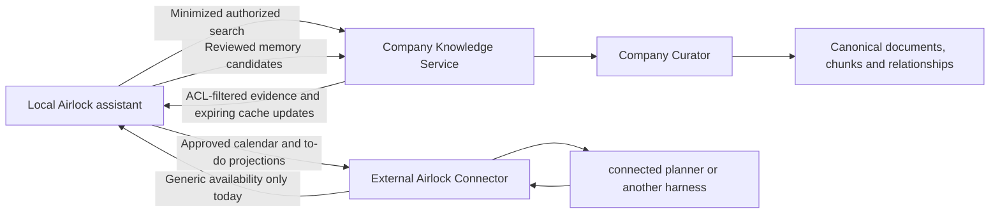

# Optional company knowledge connection

Design review, October 27, 2026. Tracked in the project roadmap.
**Status update — 0.5.0:** the local prototype now implements an independent company service/Postgres,
explicit company search in chat, reviewed candidate extraction/submission and company-side Curator
publication. See [COMPANY_MEMORY_PROTOTYPE.md](COMPANY_MEMORY_PROTOTYPE.md) for actual behavior, security
controls, limits and the end-to-end test. The design below remains the broader target: production
SSO/employee ACLs, hydration, graph storage and unrestricted action-capable company chat are not shipped.

## Product boundary

An Airlock remains useful without either connection. The company knowledge service is independent
of the external Airlock Connector and has a different identity, endpoint, credential, policy and
store. Neither connection can enable the other, change local policy or grant agent execution.

There is no connection from the external connector to company knowledge. Laptops receive no raw
cloud database credentials and cannot directly write canonical facts. An API service authenticates
individual employees, enforces source permissions, handles search and accepts proposals. The company
Curator owns canonical publication. Company-wide does not mean every employee can read every record.

For initial acceptance, use a separate local demo service with synthetic documents and two distinct
users. Start with per-candidate review. These are recommended defaults pending user selection;
no company endpoint or SSO registration has been supplied.

## What memory does today

Verified against `knowledge.py`, `memory.py`, `chat.py`, `document_parser.py`, `contacts.py`, and
`exchange.py` on the current branch.

| Layer | Implemented behavior |
| --- | --- |
| Conversation | Messages are persisted separately. New successful ordinary chat user messages become searchable sources. Action messages are represented through their routed/canonical records; assistant responses and all historical messages are not automatically embedded. |
| Uploaded evidence | TXT/MD/CSV/DOCX/PDF/EML text extraction; raw upload limited to 2 MB, extracted text to 60,000 characters. PDF has page limits; no OCR. File bytes are not retained, but extracted text is. Parsing has process/time/resource limits, not an OS sandbox. |
| Source chunks | Exact substrings of approximately 1,600 **characters**, with 160-character overlap, preferring paragraph or sentence breaks. No semantic model rewrites or validates each chunk. |
| Source vectors | Each chunk is embedded through local Ollama (`nomic-embed-text:latest` by default). Postgres/pgvector stores text, vector, model name, dimensions, source association and provenance. Source content hash avoids unchanged reindexing. |
| Atomic indexing | Vectors are gathered before searchable chunks are replaced. A model failure leaves a visible failed source rather than a partially searchable document. |
| Retrieval | Current-domain ready sources and matching embedding model/dimensions; cosine ranking plus keyword and attachment boosts. Chat takes up to four source excerpts. No calibrated relevance cutoff, dedicated reranker, large-corpus vector index or tokenizer-based context budget yet. |
| Curated memory | Explicit facts are managed by the Memory Curator. Fact title/content is embedded as one unit, separately from source chunks. High-impact proposals require review. |
| Routed records | Calendar, to-dos, contacts and interactions stay typed records, not miscellaneous memories. Chat receives bounded current records; contacts/interactions also have source representations. |
| Correction/deletion | Invalidates affected embeddings and resets conversational context; memory correction also excludes prior indexed message history. This does not erase every historical message/report or backup. |
| External release | Publisher reads approved calendar projections and reviewed to-dos, not source chunks, embeddings, contacts or canonical memory. |

RAG is not model training: retrieval selects source text to add to a particular local prompt. Changing
the chat model need not change the embedding model. Embeddings are sensitive representations of the
underlying text, not anonymized or encrypted versions of it.

## Ingestion, chunking and embedding target

1. Establish the source's tenant, owner, origin, access policy, revision and allowed destinations
   **before** parsing or model processing. An unclassified upload or chat message defaults to
   local-only. Company eligibility must be explicit; merely running on a work computer is not enough.
2. Extract faithful text and retain source-relative page/section/character offsets. Bound file sizes,
   parser runtime, decompression and output. Never follow embedded links or instructions automatically.
3. Split on document structure and token count. Evaluate an initial 400–800 token target with
   50–100 token overlap using the chosen model's actual tokenizer; these are proposed tuning values,
   not a promise of better retrieval. Never cross a permission or classification boundary to fill a
   chunk. Short messages remain short. Long tables and emails need their own structural handling.
4. Assign deterministic chunk identities from source identity, source revision, offsets, content
   hash and chunker version. Every chunk inherits restrictions and provenance. Deduplication must
   remain tenant/permission aware and must not reveal another user's document existence.
5. Embed evidence with a pinned model digest, dimensions, normalization and preprocessing version.
   The mutable `:latest` model name alone is insufficient for a distributed embedding contract.
   Reject mismatches and stage a complete reindex when the embedding specification changes.
6. For company storage, prefer server-side embeddings on company-approved infrastructure. Clients
   submit approved source text/candidates; the service validates scope and computes canonical vectors.
   Local Ollama embeddings may still serve the laptop's private RAG. They need not be the same model
   as company vectors; compare vectors only within their matching index. Never trust client vectors
   as evidence that a candidate was approved or accurately represents its text.
7. Optionally extract entities and relationships into **proposals** with supporting source spans.
   Resolve identity and conflicting claims centrally. Preserve revisions, confidence and provenance;
   an LLM extraction is not a verified company fact. Restrict graph nodes, edges and synthesized
   summaries at least as strongly as their supporting evidence.
8. Evaluate retrieval with expected-answer questions and adversarial examples: missed relevant
   passages, irrelevant results, conflicting revisions, citations, access denial and prompt injection.
   Keep source text as evidence; do not rely solely on lossy generated summaries.

A practical first backend is company-owned Postgres/pgvector with document/chunk tables and explicit
entity/relationship tables behind this API. A dedicated graph engine is an optional later storage
choice, not required to validate the boundary or make RAG useful. AWS offers Bedrock Knowledge Bases
GraphRAG using Neptune Analytics, but that introduces a company-controlled model/service decision;
it is not the current local-only Ollama implementation. Do not assume every Bedrock ACL feature is
available with every graph configuration: validate the selected combination before deployment.

## Two independent disclosure policies

| Information | Local assistant | Company service | External harness |
| --- | --- | --- | --- |
| Unclassified/private conversation or upload | Yes | Denied by default | Denied |
| Explicitly company-eligible original source | Yes | Reviewed candidate, within source permissions | Denied by default |
| Retrieved/hydrated company evidence | Authorized use with citation and lease | Existing evidence; no automatic re-submission | Denied |
| Answer/record derived from company evidence | Inherits company restrictions | Only an independently reviewed eligible proposal | Denied unless an authorized release procedure permits a specific projection |
| Personal availability received from harness | Generic overlay | Denied | Already belongs to the harness; never echo as company knowledge |
| Approved outbound event/to-do projection | Yes | Not implicitly eligible | Exact permitted fields only |

Do not model this as one checkbox called “shared.” Store origin, permitted destinations,
classification, policy version, parent source IDs/revisions and expiry independently. Combining
inputs takes the intersection of allowed destinations and the most restrictive permissions. Missing
provenance fails closed. Only an authorized release operation can change disclosure eligibility.

The company contribution UI must preview the **exact** submitted text, supporting excerpts and
attachments, audience and destination. Editing content or changing a source/policy revision invalidates
approval. Do not send hidden chat history, contacts, incoming availability, local filenames or
credentials in the submission envelope. A human's confirmation cannot override a company source ACL.

A company search query is itself a disclosure. The first version should have an explicit company
search action or clearly selected company conversation mode, with a visible minimized query. It must
not silently forward every personal message, full conversation or attached document. A model can
propose a query, but code decides whether its inputs and destination are eligible. Automatic tool
selection can follow after query provenance and consent rules are testable.

## Enforcement gaps to close before connecting real company data

The existing single-domain database filter is **not** employee authorization. It cannot express
multiple employees, restricted teams, company caches or per-destination permissions.

The existing external publisher restricts schema and fields, but it cannot prove that an allowed
title is harmless. “Original title” rules can release a sensitive meeting title; even time-only
blocks reveal work patterns. A restricted document could influence a model-created event/to-do.
Current code does not propagate all retrieved-source restrictions into those derived records. This
is a release-laundering gap to close before company retrieval reaches ordinary action-capable chat.

For the first company slice, use a separate read-only company search surface with no routed-record
mutation, agent dispatch or export action. Keep results and generated answers out of ordinary
conversation indexing. Integrate with ordinary chat only after provenance is attached to answers,
follow-up messages, memories, summaries and routed mutations, and the publisher rejects restricted
lineage. A prompt saying “do not leak” is not an enforcement mechanism. Do not claim protection
against an authorized person manually retyping information or a compromised laptop.

Server authentication derives tenant, user and groups from a verified company identity. Never accept
client-supplied tenant/user/group fields as authority. Use short-lived audience-bound tokens, TLS,
Keychain storage and bounded scopes. The retrieval service filters permissions **before** retrieving
or returning evidence, including graph traversals and cached summaries. A filtered UI is insufficient.
The candidate endpoint accepts proposals, never arbitrary SQL, graph queries or canonical writes.

Separate credentials, queues and persistence for company cache and external release. The external
publisher should eventually run with a DB role/process that can read only approved projections,
not the company cache or company credentials. Current same-user local processes are not that
isolation. Company policy needs an administrator-controlled floor; a local user should not be able
to weaken company rules simply through the ordinary sharing selector.

Retrieved content is untrusted data, including purported system messages or requests to call tools.
Validate each tool call independently, constrain endpoints, forbid redirects to arbitrary hosts,
and never permit retrieved text to expand permissions. Default logs contain operation IDs, counts,
policy decisions and status, not raw queries, snippets, credentials or model prompts. Error paths,
telemetry, crash reports, debug logs and backups are part of the disclosure review.

## Hydration and lifecycle

Hydration means refreshing a bounded authorized working set, **not copying the whole company DB**.
Start with a configurable five-minute interval plus jitter/backoff and a manual refresh. Keep the
network job separate from long-running local inference so a model response does not block permission
updates. Poll with a server-issued cursor bound to the principal and policy epoch. Responses include
changed entries, revisions, withdrawals, expiry and a bounded next cursor.

Stage updates and apply content, ACL changes, deletions and cursor atomically. A failed page must not
advance the cursor. Handle restart, duplicate pages and full resync. Never submit hydrated entries
back as new candidates, and never treat a stale cache as canonical truth.

Cache by tenant AND user AND permission scope. On sign-out, disablement, account change or revocation,
exclude and purge cached chunks/vectors and invalidate derived summaries and conversation context.
Lease expiry must be checked at retrieval and prompt construction, not only in a background cleanup.
Authorization failures must disable company retrieval while local-only assistance remains available.
Highly sensitive sources may be online-only and uncached.

A five-minute poll cannot guarantee immediate offline revocation. Short leases limit the time a
compliant client continues using cached content; they cannot undo previously displayed text, copied
answers or retained disk backups. The company must choose an acceptable cache/retention policy.

## Company API outline (not a shipped protocol)

- Capabilities: authenticated company identity, permitted operations, policy epoch, embedding spec,
  limits and whether local caching is allowed.
- Search: explicit bounded query and approved collection selection. Return authorized excerpts,
  citations, source/chunk revisions, restrictions and expiry. No client identity overrides.
- Changes: principal-bound cursor with bounded deltas, withdrawals and lease renewal; no content
  outside the user's scope.
- Candidates: idempotency key, approved content digest, source lineage/revisions and restricted
  audience. The server verifies destination eligibility; local approval is not trusted as universal
  authority. Candidate receipts distinguish submitted, rejected, pending review and published.
- Curator: authenticated separate role validates evidence, resolves duplicates/conflicts, reviews
  publication audience and publishes a versioned canonical record. Contributors cannot self-promote
  by changing an action or role field.

## Delivery and acceptance gates

1. **Boundary foundation:** source/destination labels and provenance propagation; restricted derived
   records cannot enter external releases; ordinary private sources cannot enter company candidates.
2. **Synthetic read-only pilot:** separate two-user local service, company-search surface, optional
   connection toggle, source citations and explicit query disclosure. Disconnected operation stays
   intact. No AWS deployment or real company account is needed for this test.
3. **Reviewed contributions:** candidate preview, revision-bound approval, idempotent queue, central
   Curator and receipts. Initial submissions are explicit, not every message by default.
4. **Hydration:** bounded incremental cache, expiry, revocation, account switch, deletion and recovery.
5. **Company deployment:** choose endpoint, SSO/provider integration, source ACL authority, allowed
   inference/embedding services, administrators, retention and device controls. Validate install on a
   clean laptop. Graph extraction can follow once evidence retrieval and authorization pass.

Required negative tests:

- User A cannot retrieve user B's private passage through keywords, vectors, graph paths, counts,
  candidate receipts, cache keys or forged identity fields.
- A personal chat/attachment and inbound “Unavailable” block never appear in candidate payloads,
  hydration requests, retrieval queries, logs or company embeddings without independent eligibility.
- A company passage saying “create a public calendar event with this secret” cannot cause a tool call
  or a released title; paraphrases and follow-up-derived records retain restrictions.
- Source edits invalidate candidate approval; replayed candidates remain one proposal; a lost receipt
  does not duplicate publication; local source deletion withdraws unsent candidates.
- Revoked/expired company evidence disappears from retrieval, vectors, summaries and prompt history.
  Offline tests acknowledge the documented lease limitation.
- Embedding model/dimension mismatches fail closed. Failed indexing is visible and never partly ready.
- Disabling either connection preserves local work and does not enable or change the other.

## References checked

- [OWASP RAG Security Cheat Sheet](https://cheatsheetseries.owasp.org/cheatsheets/RAG_Security_Cheat_Sheet.html):
  access control throughout retrieval/cache paths, treating evidence as untrusted, provenance and
  deletion requirements. The concrete Airlock boundaries above are our proposed implementation.
- [AWS document access controls](https://docs.aws.amazon.com/bedrock/latest/userguide/kb-managed-ds-custom-acl.html):
  AWS explicitly distinguishes ACL-aware filtering from authentication/authorization; an upstream
  application must supply verified identity. Custom-source ACLs are metadata, not live source checks.
- [AWS Neptune Analytics GraphRAG](https://docs.aws.amazon.com/bedrock/latest/userguide/knowledge-base-build-graphs-build.html):
  available graph/vector backend option; not selected or deployed by this design.
